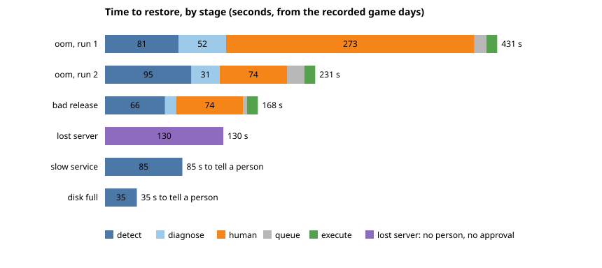

# Lab 50 — Closing Phase 5: readiness checks, the time-to-restore chart, and Prometheus in production

**Phase:** 5, slice 7 · **Cost:** Part 1 about $0 (tests only) plus about 30 minutes of staging (~$0.03);
the production roll-out is a few hours of production (about 5 cents an hour) and nothing recurring

Slices 1 to 6 proved Kaval on staging. This slice closes the phase: the last open findings, a chart of
what the game days measured, and then, only on your say-so, production. It grows in three parts, one
pull request each; the parts built so far are below.

Decisions: [ADR-0051](../adr/0051-closing-phase-5-readiness-checks-prod-prometheus-and-the-disk-trend.md).

## Prerequisites

- [Lab 49](lab-49-people-and-process.md) done; `helm` and Docker installed (chart render, promtool)
- `AWS_PROFILE=kaval` for the staging proof

---

## Part 1 — readiness checks, the chart, production's settings

### Step 1 — the checks, tested by rendering the real chart

```bash
pytest scripts/dev/test_chart_probes.py -q
helm template k deploy/charts/kaval -f deploy/environments/prod/values.yaml | grep -B2 -A6 "readinessProbe"
```

Each of the agent, executor, collector and the Prometheus poller has a check that connects to its
health page (`:9100`, named `metrics`). Read the negative tests: no liveness check is allowed on them
(a restart because the database is slow makes a bad hour worse), and the same checks must render in
staging, production and local. To see a test fail for the right reason, delete the one line
`{{- include "kaval.workerReadiness" . | nindent 10 }}` from `templates/agent.yaml` and run it again:
four tests fail. Put the line back.

### Step 2 — production's settings are the written settings

```bash
pytest scripts/dev/test_gitops_values_in_sync.py scripts/dev/test_chart_chaos.py -q
```

Production now has `prometheus.enabled`, `prometheus.database.enabled` and one timed service (its own
gateway) in both copies of its settings, and the test that keeps the copies equal passes. The prod
render still holds no chaos object, and the disk line is the chart's `0.85`.

### Step 3 — the chart of what the game days measured

```bash
python scripts/dev/mttr_chart.py            # redraws docs/architecture/mttr.svg
pytest scripts/dev/test_mttr_chart.py -q
```



The numbers are copied from each post-mortem into `docs/architecture/mttr-runs.json` (staging takes its
database, and `make mttr`, with it when it is destroyed). Change one total by a second and the test
says which run no longer adds up. Reading it: the person's wait is the orange bar and, in the first oom
run, 63 percent of the whole; the machine's own time is the same size in every fix (about two and a half
minutes); a lost server heals with nobody acting in about two minutes ten.

### Step 4 — the staging proof (after this part is merged and released to staging)

*Filled in after the run.* The plan: bring staging up on the released version, run the bad-release game
day again and then break one of the background programs on purpose with a release that dies on
start-up. Expected: the old pod stays `1/1 Running`, the new pod stays `0/1`, no incident for a stopped
service, and `kubectl rollout undo` puts it right.

## Done when

- [x] Readiness checks on the four background programs, rendered in every environment (tests)
- [x] Production's settings turn Prometheus, the database exporters and a gateway check on (tests)
- [x] The time-to-restore chart and its arithmetic test
- [x] The disk-trend decision recorded with its trigger (ADR-0051)
- [ ] The staging proof of Step 4
